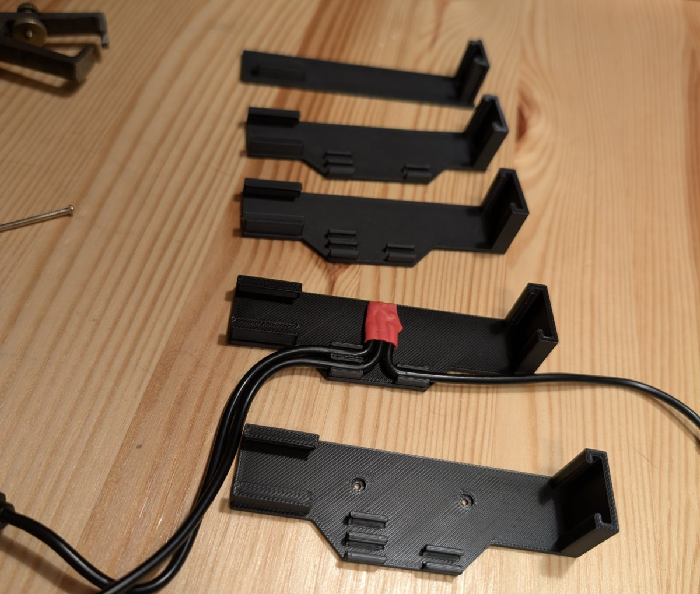
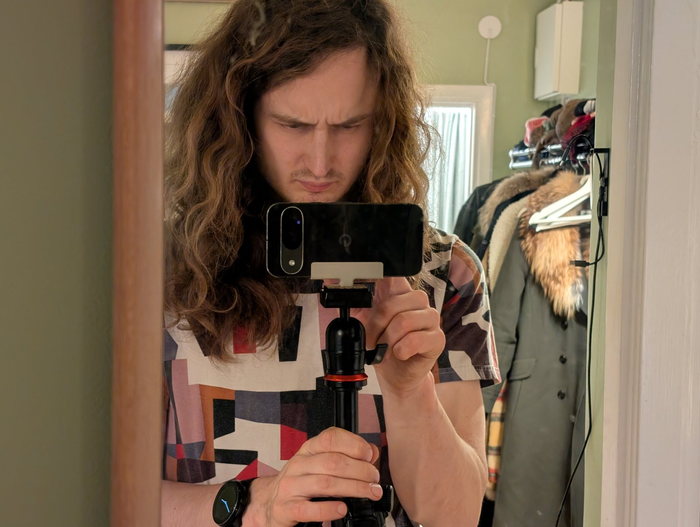

I fell for a Black Friday deal and bought a 3D printer. To justify it, I set out to learn CAD by designing something somewhat useful: a wall mount and charging station for the bike lights I keep misplacing and forgetting to charge.

Five prints later, with every tolerance tweaked to correct (well, acceptable), I felt the kind of pride in a flimsy piece of plastic that only _real_ struggle can instill.

Rather than suppress that pride like the delusion it is, I decided to sell it to friends and family, and selling pride takes a _commercial_. So I rendered the CAD as a blueprint and started shooting a stop motion of the holder in action. That's when I realised I had no way to get my phone onto a tripod, and no decent app to shoot with. Undeterred, I went back to the CAD and the printer for a [phone holder](https://cad.onshape.com/documents/cb74e38cf4bbef518075b862/w/98bc3acc6f83876a08b28152/e/2d671732bfa03c37a8a04685), and vibe coded (as fuck) a [stop motion web app](https://demborg.se/stopmotion/).

The result may be a piece of plastic and an animation only a father could love. But this father is proud.
